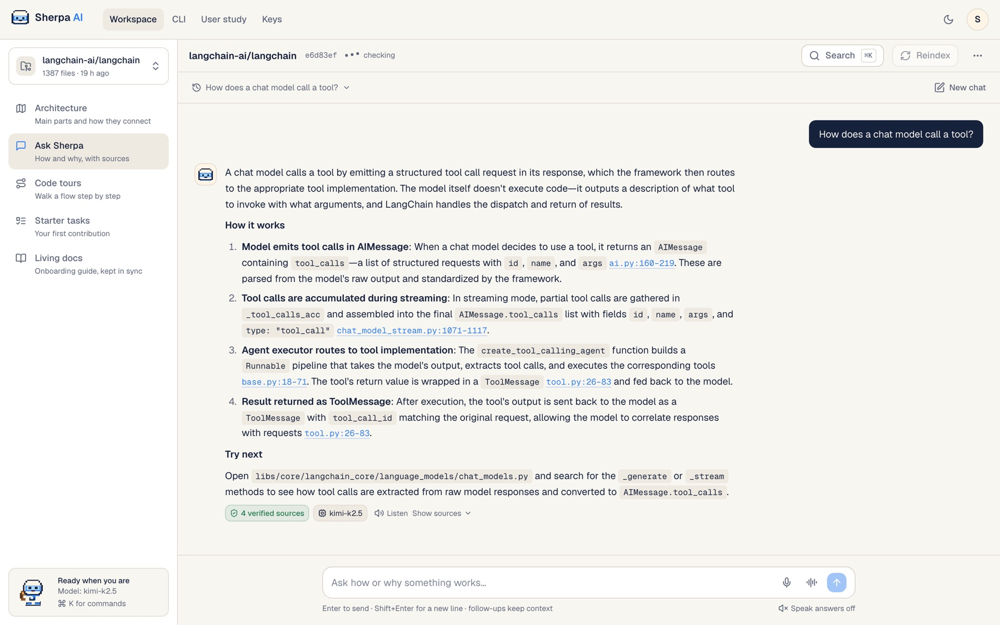
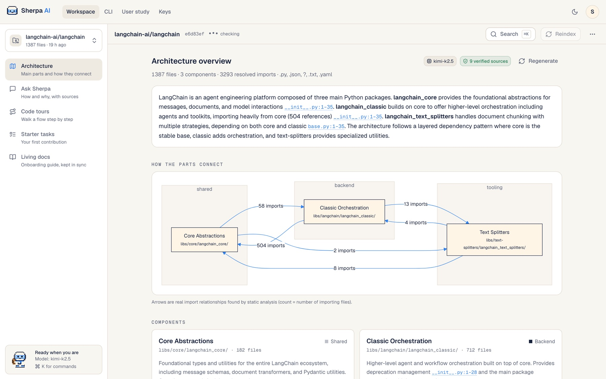
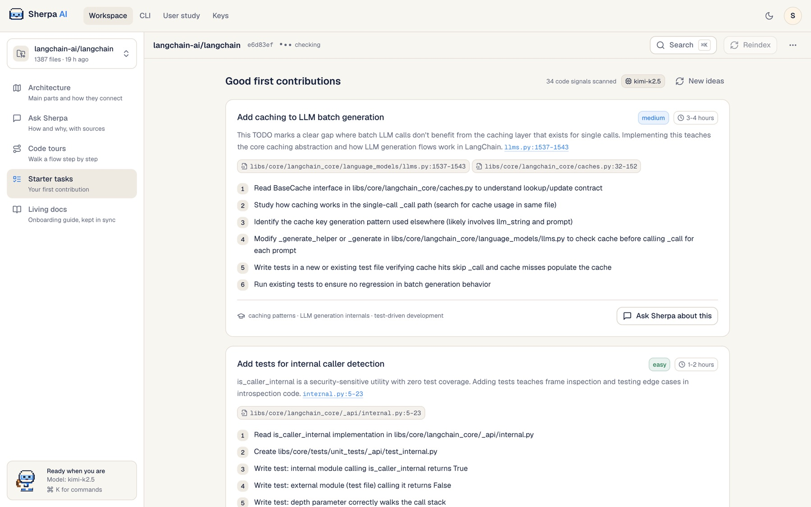
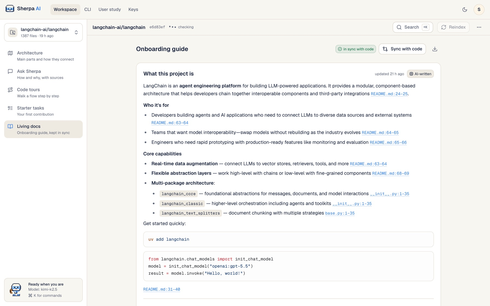
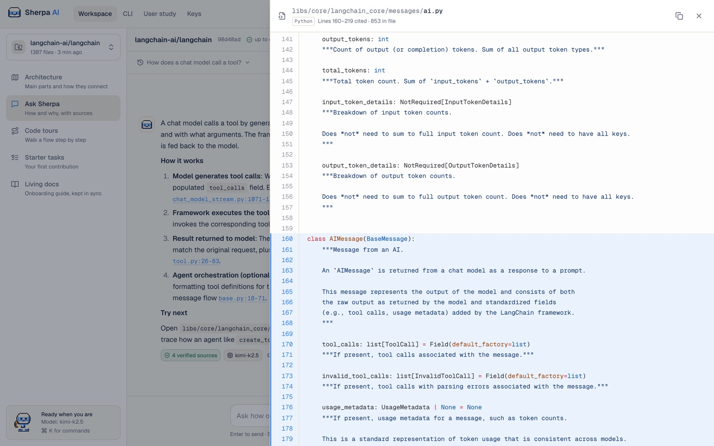
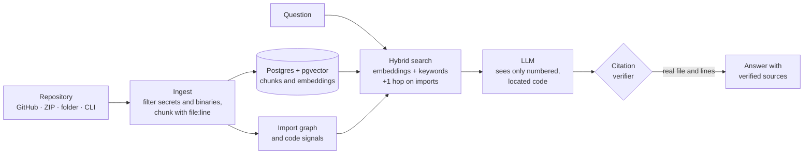

<div align="center">


# Sherpa AI

### Your codebase, explained.

Sherpa reads a repository and walks a new engineer through it: an architecture map, answers, guided tours and first tasks. Every claim cites the exact file and line it comes from, and is checked before you see it.

[](https://github.com/SurajsinghBayas/sherpa-ai-mentor/actions/workflows/ci.yml)
[](https://github.com/SurajsinghBayas/sherpa-ai-mentor/actions/workflows/desktop.yml)


[**Watch the 30-second film**](apps/web/public/ads/sherpa-ad3-horizontal.mp4) · [Quickstart](#quickstart) · [Deploy](docs/deployment_guide.md) · [How it works](docs/how-it-works.md)

<br />



</div>

---

## Why Sherpa

A new engineer takes months to become fully productive, and much of that time goes to finding their way around unfamiliar code and waiting on busy teammates for answers. General coding assistants are built to *write* code; Sherpa is built to help someone *understand* it, and it never answers without showing where the answer came from.

- **Grounded, not guessed.** Answers come from the indexed code. A verifier checks every citation against the snapshot and removes any that don't exist.
- **A guided path, not a blank chat box.** Architecture first, then tours of real flows in execution order, then a first pull request.
- **Built for teams' real code.** Private repositories, a private mode that stores nothing, and a server you deploy in your own AWS account.

## What it does

| | |
|---|---|
| **Architecture map** | Resolves the real import graph (Python and JS/TS), groups files into components, and explains how they connect, with import counts on every arrow. |
| **Ask Sherpa** | How and why answers with follow-ups. Every `[file:12-30]` is a chip that opens those exact lines in a code viewer with syntax highlighting. |
| **Code tours** | "What happens when a user signs up?" becomes an ordered walk from UI to API to logic to data, each stop showing the code. Sherpa can narrate it aloud. |
| **Starter tasks** | Real first-PR ideas from code signals (TODOs, untested modules, long functions), with the files to touch, the steps and an effort estimate. |
| **Living docs** | An onboarding guide written from the code. When files change, only the sections that cite them are flagged and rewritten. |
| **Voice** | Hands-free conversation: ask out loud, hear the answer (Amazon Polly), and interrupt at any time, like a call with a senior engineer. |
| **Private mode** | Code stays in server memory only and expires after a few hours. Private repos are cloned with a one-time token that's never stored. |
| **Everywhere** | Web app, native macOS and Windows apps, and a `sherpa` CLI that uploads a project and asks questions from the terminal. |

<table>
  <tr>
    <td width="50%"><br /><sub><b>Architecture map</b>: components and the imports between them</sub></td>
    <td width="50%"><br /><sub><b>Starter tasks</b>: first contributions with files and steps</sub></td>
  </tr>
  <tr>
    <td width="50%"><br /><sub><b>Living docs</b>: an onboarding guide that stays in sync with the code</sub></td>
    <td width="50%"><br /><sub><b>Verified sources</b>: a citation opens the exact lines, highlighted</sub></td>
  </tr>
</table>

## How it works



1. **Every chunk knows where it lives.** Code is split along functions and classes and keeps its `file:start-end`. Chunks are embedded once (Amazon Nova) and reused across re-indexes and users.
2. **The model can only cite what it was shown.** Context is labelled by location; tours and tasks pick from numbered candidates, so a step can't point at invented code.
3. **The verifier is the gate.** Each citation must resolve to a real file and line range. Invalid ones are removed; an answer with none is retried once and otherwise labelled unconfirmed.

On the demo repository, **97% of citations were valid and 10 of 10 answers cited the file a maintainer would point to** ([eval](evals/results.md)). More in [How Sherpa works](docs/how-it-works.md).

## Quickstart

**Requirements:** Python 3.11+, Node 20+. Postgres and a model key are optional: without them Sherpa uses SQLite, keyword search and an offline answer composer.

```bash
git clone https://github.com/SurajsinghBayas/sherpa-ai-mentor.git && cd sherpa-ai-mentor
cp .env.example .env                       # add model keys here (optional)

pip install -r services/api/requirements.txt
make api                                   # API on http://localhost:8000

cd apps/web && npm install && npm run dev  # app on http://localhost:3000
```

Sign up, paste a repository URL (try `https://github.com/fastapi/full-stack-fastapi-template`) and choose **Index repository**. A mid-sized project takes about a minute.

Or run the whole stack, including Postgres with pgvector, in Docker: `docker compose up --build`.

## Get it

| | |
|---|---|
| **Web** | Deploy to your own AWS account on one EC2 instance, with HTTPS and no SSH: [deployment guide](docs/deployment_guide.md) |
| **macOS and Windows** | Installers (`.dmg`, `.exe`, `.msi`) are built by [GitHub Actions](https://github.com/SurajsinghBayas/sherpa-ai-mentor/actions/workflows/desktop.yml) on every change. Build locally with `make desktop-build`. See [apps/desktop](apps/desktop/README.md) |
| **CLI** | `curl -fsSL <your-server>/cli/sherpa.py -o sherpa`, then `sherpa login`, `sherpa upload ./project`, `sherpa ask`. See [cli](cli/README.md) |

## Security and privacy

- **Private mode:** code, vectors and generated docs are held in memory only, never written to the database, and wiped on expiry, delete or restart.
- **Secrets stay out:** `.env` files, keys, databases and binaries are never indexed; uploads are filtered on your machine before anything is sent.
- **Your repos are yours:** every repository is scoped to its owner; other users get a 404.
- **Safe by default in production:** the API refuses to start with weak secrets, an unencrypted database connection or open CORS; rate limits, quotas, SSRF checks and hardened git clones are always on.
- **Models don't keep your code:** Amazon Bedrock doesn't store prompts or use them for training. You can also bring your own key or a self-hosted model (Ollama or any OpenAI-compatible endpoint).

Details: [Security and privacy](docs/security.md).

## Built with

| Layer | Technology |
|---|---|
| Web and desktop | Next.js 14, React 18, TypeScript, Tailwind CSS, Framer Motion, Shiki; Tauri 2 for macOS and Windows |
| API | Python 3.11, FastAPI, SQLAlchemy 2, Alembic |
| Data | Amazon RDS for PostgreSQL with pgvector (SQLite locally) |
| AI | Kimi K2.5 with Qwen3-Coder and DeepSeek V3.2 fallbacks on Amazon Bedrock; Amazon Nova embeddings; Amazon Polly voice |
| Hosting | Docker, Caddy (automatic HTTPS), AWS EC2 with SSM, GitHub Actions |

## Documentation

| Doc | Contents |
|---|---|
| [How Sherpa works](docs/how-it-works.md) | Grounding pipeline, model benchmark, bringing in code, CLI |
| [Deployment guide](docs/deployment_guide.md) | AWS EC2 on Ubuntu, without SSH, step by step |
| [Database setup](docs/rds_setup.md) | Amazon RDS for PostgreSQL with pgvector |
| [Configuration](docs/configuration.md) | Every environment variable |
| [API reference](docs/api.md) | All endpoints, private mode, keeping the index current |
| [Security and privacy](docs/security.md) | Private mode and production guardrails |
| [Architecture](docs/architecture.md) | System design |
| [Roadmap](docs/future_scope.md) | What's next |

## Development

```bash
make test        # 90 backend tests, offline: they never call a paid model or send email
make eval        # live grounding eval against the demo repository
make desktop     # desktop app in development, with hot reload
```

```
services/api/   FastAPI app: ingest, retrieval, agents (mentor, overview, tours, tasks, docs), voice, private mode
apps/web/       Next.js app: workspace panels, code viewer, voice mode, landing page
apps/desktop/   Tauri 2 shell that packages apps/web for macOS and Windows
cli/            the `sherpa` command (Python standard library only)
deploy/ec2/     user data, deploy script, Docker Compose and Caddy for one-instance AWS hosting
evals/          golden questions, eval runner, results, user-study protocol
docs/           guides and reference
```

## Built for CODE APEX 3.0

Sherpa was built for the iMocha track, problem statement **IM-05: Codebase Mentor, AI Onboarding for Developers**.

<details>
<summary>How each IM-05 requirement is met</summary>

| IM-05 asks for | Sherpa |
|---|---|
| Architecture overview: main parts and how they connect | **Architecture** tab: real import graph, components, a diagram with import counts, cited explanations, key flows and start-here files |
| Guided tours of key flows | **Code tours** tab: candidate code plus one hop on the import graph, ordered in execution order, each step with line-numbered code; can be narrated |
| How and why answers linked to exact files and lines | **Ask Sherpa** tab: grounded Q&A with follow-ups; every citation opens the cited lines |
| Suggested starter tasks | **Starter tasks** tab: TODOs, untested modules, long functions and missing docs turned into first-PR tasks with steps, effort and files |
| *Optional:* docs that stay up to date | **Living docs**: each section records the hashes of the files it cites; **Sync with code** rewrites only the stale ones, keeping a changelog |
| Works on a real open-source repository | Demo: [`fastapi/full-stack-fastapi-template`](https://github.com/fastapi/full-stack-fastapi-template) (219 files); shown above on [`langchain-ai/langchain`](https://github.com/langchain-ai/langchain) (1,387 files) |
| Every answer cites code so it can be checked | The citation verifier checks every reference against the snapshot and the UI shows how many were verified |
| Small peer test showing newcomers get faster | Built-in **User study** tool: timed tasks for a control group and a Sherpa group, scored against a rubric, with a chart and CSV export ([protocol](evals/user_study.md)). Results come from real participants only |

</details>

## Credits

Built with help from Claude Code (Anthropic). At runtime Sherpa uses models on Amazon Bedrock and Amazon Polly. Open-source libraries: FastAPI, Pydantic, SQLAlchemy, Alembic, pgvector, scikit-learn, httpx, boto3, Next.js, React, Tailwind CSS, Framer Motion, Shiki, Mermaid, Tauri and others. Demo repository: [fastapi/full-stack-fastapi-template](https://github.com/fastapi/full-stack-fastapi-template) (MIT). No API keys are committed.

## License

[MIT](LICENSE) © 2026 Suraj Bayas
